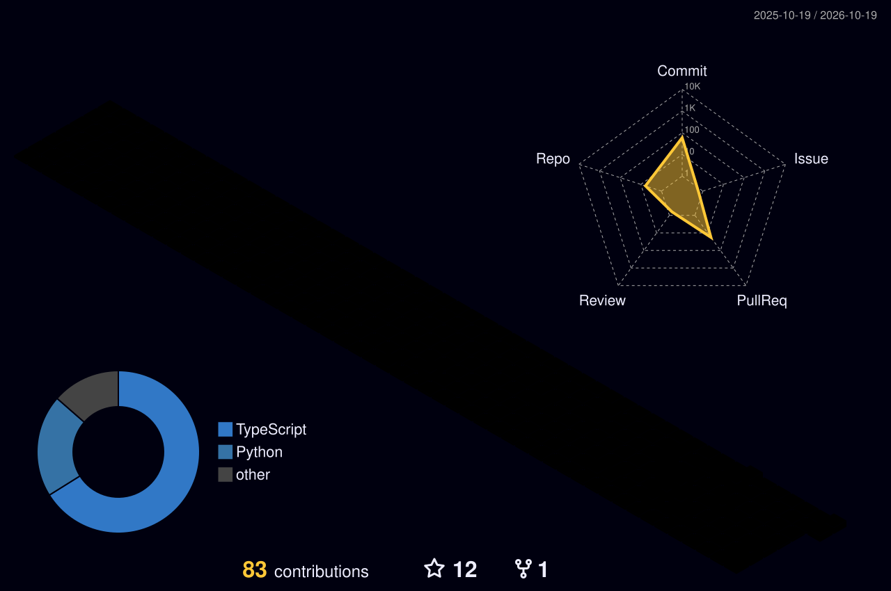

<div align="center">

<!-- ANIMATED BANNER -->


<!-- TYPING ANIMATION -->
<a href="https://klbramhananda-portfolio.vercel.app">
  
</a>

<br/>

<a href="https://klbramhananda-portfolio.vercel.app"></a>
<a href="https://linkedin.com/in/bramhanandakl/"></a>
<a href="mailto:bramhanandakl2030@gmail.com"></a>


</div>

---

<div align="center">

```
╔══════════════════════════════════════════════════════════════════╗
║                                                                  ║
║   > whoami                                                       ║
║     Bramhananda K L — Software Engineer                          ║
║     Currently @ HG Infotech, Bengaluru                           ║
║     Building: 10xTA — AI-Powered Talent Acquisition (B2B SaaS)   ║
║     Stack: Node.js · TypeScript · PostgreSQL · Java · React      ║
║                                                                  ║
║   > status                                                       ║
║     Open to Full Stack, Backend & AI opportunities 🚀            ║
║                                                                  ║
╚══════════════════════════════════════════════════════════════════╝
```

</div>

---

## ⚡ About Me

```yaml
name       : Bramhananda K L
role       : Software Engineer
company    : HG Infotech, Bengaluru (On-site)
experience : 2+ Years
focus      : Full Stack · Multi-Tenant SaaS · Enterprise Applications · AI Integration
speciality : Node.js · TypeScript · PostgreSQL (RLS) · Java · Spring Boot · React · SAP BTP
email      : bramhanandakl2030@gmail.com
portfolio  : https://klbramhananda-portfolio.vercel.app
status     : Open to Full Stack, Backend & AI Opportunities 🚀
```

---

## 🛠️ Tech Arsenal

<div align="center">

### 🔷 Backend & Core


### 🤖 AI


### 🔶 Frontend


### 🗄️ Data, Cloud & Enterprise


### ⚙️ Tools & Practices


</div>

---

## 💼 Work Experience

> 💡 Click a project to expand it.

### 🚀 Software Engineer — **HG Infotech** · Bengaluru *(Feb 2025 – Present)*

<details open>
<summary><b>🟢 10xTA — AI-Powered Talent Acquisition Platform (B2B Multi-Tenant SaaS)</b> · <i>Apr 2026 – Present</i></summary>
<br/>

- 🧭 Leading the **Recruiter module**, owning technical planning, Jira task breakdown, dependencies and delivery coordination across engineering and product teams
- 🤖 Developing an **AI-powered interview scheduling system**: AI-conducted, human-led and hybrid interviews, with scheduling, rescheduling, cancellation and **RBAC** for recruiters, hiring managers and admins
- ⚡ Building scalable **RESTful APIs with Node.js and TypeScript** for jobs, candidates, applications, interviews and scheduling, following microservices and API Gateway patterns
- 🔐 Implementing secure **multi-tenant PostgreSQL** with **Row-Level Security (RLS)** and tenant-aware authorization for client data isolation
- 🔍 Analysing **400+ product features** against Figma designs, the codebase, APIs, database models and Jira requirements to surface gaps, risks and roadmap priorities
- ☁️ Participating in the **SAP HANA Cloud** and **SAP SuccessFactors** migration and environment configuration management
- 🤝 Collaborating with product owners, architects, designers and QA in Agile/Scrum

`Node.js` `TypeScript` `PostgreSQL` `RLS` `RBAC` `Microservices` `API Gateway` `SAP HANA Cloud` `SAP SuccessFactors`

</details>

<details>
<summary><b>✈️ Fastays.com — B2C Travel Booking Platform (Flights, Hotels, Tours, Buses)</b> · <i>Feb 2025 – Mar 2026</i></summary>
<br/>

- 🏗️ Designed and developed scalable backend **microservices** using Java, Spring Boot and MongoDB
- ⚛️ Developed **5+ responsive frontend modules** using React, JavaScript and API integration
- ⚡ Designed low-latency, high-throughput **REST APIs** for real-time booking and payment systems
- 🔀 Implemented an **API Gateway** to improve inter-service communication, security and performance
- 📡 Implemented **event-driven communication with Apache Kafka** for scalability, reliability and fault tolerance
- 🌍 Integrated **third-party APIs** for real-time availability of flights, hotels, tours and buses

`Java` `Spring Boot` `MongoDB` `Kafka` `React` `API Gateway`

</details>

### 🌱 Junior Software Engineer — **HG Infotech** · Bengaluru *(Aug 2024 – Jan 2025)*

<details>
<summary><b>📦 Procurement Service Platform</b></summary>
<br/>

- 🧩 Contributed to full-stack development using Java, Spring Boot, MongoDB, JavaScript, HTML and CSS
- 🔄 Built internal modules to streamline procurement workflows across Sales, HR and Finance
- 📉 **Reduced manual coordination efforts by 35%** through process automation
- 🤖 Assisted in developing AI-assisted candidate matching and recruitment workflow features

`Java` `Spring Boot` `MongoDB` `JavaScript`

</details>

> ✅ Promoted to Software Engineer within 6 months based on performance

---

## 🎯 Featured Builds

<div align="center">

<table>
<tr>
<td width="50%" valign="top">

### 🧑‍💼 10xTA
*AI-Powered Talent Acquisition · B2B Multi-Tenant SaaS*

| | |
|---|---|
| 🤖 | AI, human-led & hybrid interview scheduling |
| 🔐 | Multi-tenant PostgreSQL with RLS |
| 🛡️ | RBAC for recruiters, managers, admins |
| ⚡ | Node.js + TypeScript microservices |
| 🧭 | Recruiter module lead |

</td>
<td width="50%" valign="top">

### 🤖 S2P Matrix
*AI-Powered Source-to-Pay Procurement*

| | |
|---|---|
| 🤖 | Procurement assistant with conversation memory |
| 📦 | Vendors · RFQ · PO · GRN · Invoices |
| 💳 | Payments, reconciliation, audit trail |
| 📊 | Procurement dashboards & ERP console |
| 🧠 | Extensible LLM architecture (local → cloud models) |

</td>
</tr>
</table>

</div>

---

## 🧊 Contributions in 3D

<div align="center">

<picture>
  <source media="(prefers-color-scheme: dark)" srcset="./profile-3d-contrib/profile-night-rainbow.svg" />
  <source media="(prefers-color-scheme: light)" srcset="./profile-3d-contrib/profile-green-animate.svg" />
  
</picture>

<picture>
  <source media="(prefers-color-scheme: dark)" srcset="https://raw.githubusercontent.com/KLBramhananda/KLBramhananda/output/github-snake-dark.svg" />
  <source media="(prefers-color-scheme: light)" srcset="https://raw.githubusercontent.com/KLBramhananda/KLBramhananda/output/github-snake.svg" />
  
</picture>

</div>

---

## 📊 GitHub Stats

<div align="center">


<br/><br/>


</div>

---

## 🏆 Achievements & Certifications

```text
🏅 Promoted from Junior Software Engineer to Software Engineer within 6 months
🧭 Leading the Recruiter module of 10xTA, a B2B multi-tenant SaaS platform
🔐 Built multi-tenant PostgreSQL isolation with Row-Level Security
🔍 Analysed 400+ product features to drive roadmap priorities
⚙️ Reduced manual coordination efforts by 35% through process automation
📡 Implemented Kafka-based event-driven architectures
☁️ SAP HANA Cloud & SAP SuccessFactors migration
☕ Java – HackerRank Certified
☁️ AWS Cloud Computing – AWS Training & Certification
🎓 Full Stack Web Development + DSA Training
```

---

## 🎓 Education

| Degree | Institute | Score | Year |
|--------|-----------|-------|------|
| B.Tech – ECE | Reva University | CGPA: 7.8 | 2021–2024 |
| Diploma – ECE | GPT Turuvekere | 83% | 2018–2021 |

---

## 🌐 Connect With Me

<div align="center">

[](https://klbramhananda-portfolio.vercel.app)
[](https://linkedin.com/in/bramhanandakl/)
[](https://github.com/KLBramhananda)
[](mailto:bramhanandakl2030@gmail.com)

</div>

---

<div align="center">


*"Code is not just syntax — it's the architecture of ideas."*

</div>
